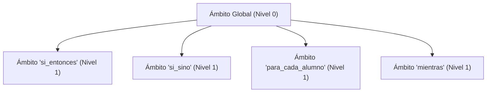
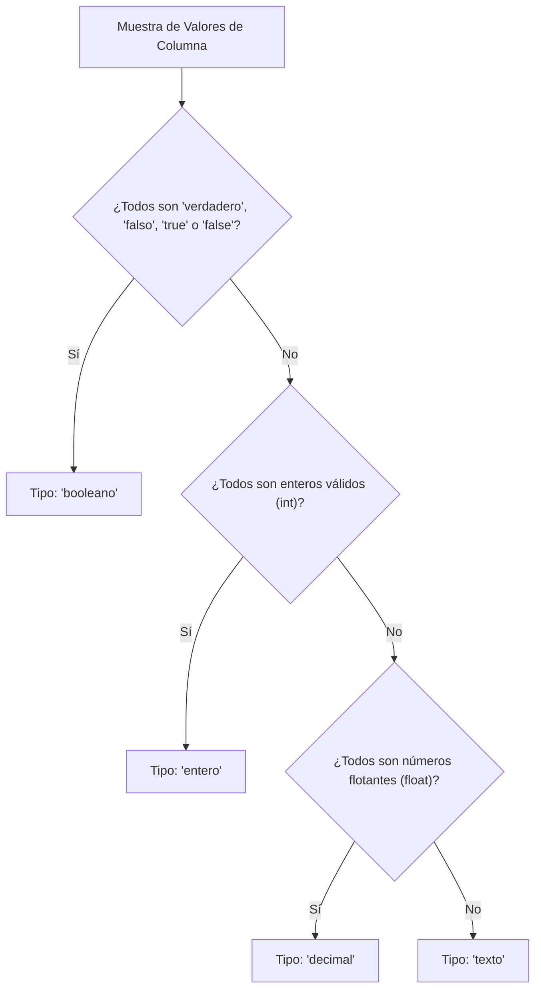

# Documentación Formal: Módulo 1 - Análisis Semántico y Base Léxica/Sintáctica
**Lenguaje:** StatQL (Statistical Query Language DSL)  
**Proyecto:** Compilador de Dominio Específico para Análisis Estadístico y Árboles de Decisión  
**Módulo:** 1 — Análisis Semántico y Verificación de Tipos  
**Fecha:** 2026-11-17  
**Estado:** Terminado y Validado (100% de Pruebas Unitarias Aprobadas)

---

## 1. Introducción y Objetivos del Módulo 1

El presente documento constituye el reporte formal de ingeniería del **Módulo 1 (Análisis Semántico)** para el compilador del lenguaje **StatQL**, un Lenguaje de Dominio Específico (DSL) desarrollado en español para la manipulación y análisis de datos tabulares (CSV) y el entrenamiento automatizado de modelos de aprendizaje automático (Árboles de Decisión).

### Objetivos Técnicos Cumplidos
1. **Verificación Estática de Tipos**: Validación rigurosa de compatibilidad en declaraciones, asignaciones y expresiones aritméticas, lógicas y relacionales.
2. **Coerción y Promoción Explícita (`I2D`)**: Transformación controlada de enteros a decimales mediante la inserción explícita de nodos `I2DNode` en el Árbol de Sintaxis Abstracta (AST), prohibiendo estrictamente la democión implícita (`decimal -> entero`).
3. **Inspección Dinámica de Esquemas CSV**: Validación semántica de archivos CSV en tiempo de compilación con mapeo explícito de valores `"verdadero"` y `"falso"` al tipo primitivo `booleano`.
4. **Control Jerárquico de Ámbitos (Lexical Scoping)**: Manejo de visibilidad y vida útil de variables en bloques condicionales (`si`, `sino`), iteradores de bucles (`para cada`) y bucles condicionales (`mientras`).
5. **Tabla de Direcciones Simbólicas y Referencias**: Generación de identificadores de memoria simbólica unívocos para cada símbolo y seguimiento de accesos.
6. **Interfaces Desacopladas**: Puntos de integración limpios para que los **Integrantes 2 (Código Intermedio - Cuádruplas)** y **3 (Optimización)** consuman el AST decorado y las tablas de símbolos sin acoplamiento.

---

## 2. Arquitectura del Repositorio

El módulo sigue estrictamente la arquitectura modular desacoplada:

```text
statql/
├── __init__.py            # Exportaciones públicas de clases y contratos del compilador
├── lexer.py               # Analizador léxico UTF-8 con máxima coincidencia y manejo de saltos de línea
├── parser.py              # Parser descendente recursivo basado en la gramática EBNF formal
├── ast_nodes.py           # Nodos del AST con campos inferred_type, address y Pretty-Printer
├── symbol_table.py        # Tabla de símbolos en árbol y tabla de direcciones simbólicas/referencias
├── semantic_stack.py      # Pila semántica explícita para evaluación de tipos y control de marcos
├── semantic_analyzer.py   # Verificador semántico principal, visitante de AST y emisor de errores
└── csv_loader.py          # Inspector de esquemas CSV con inferencia de tipos y mapeo booleano
tests/
└── semantic/
    ├── test_valid_reference.py       # Caso de referencia integral válido
    ├── test_undeclared_vars.py       # Detección de variables y columnas no declaradas
    ├── test_incompatible_types.py    # Operaciones, asignaciones y condiciones incompatibles
    ├── test_out_of_scope.py          # Variables fuera de alcance (sino, bucles, iteradores)
    └── test_casting_rules.py         # Conversiones válidas (I2D) vs demociones prohibidas
docs/
└── 01_analisis_semantico.md          # Este documento formal
```

---

## 3. Especificación Léxica y Sintáctica Base

### 3.1 Alfabeto y Reglas Léxicas (`lexer.py`)
- **Codificación**: UTF-8 estricto. Admite caracteres propios del español (`á, é, í, ó, ú, ü, ñ`, tanto en mayúsculas como en minúsculas) en identificadores (`año`, `clasificación`, etc.).
- **Sensibilidad a Mayúsculas**: Los identificadores distinguen entre mayúsculas y minúsculas (`datos != Datos != DATOS`).
- **Palabras Reservadas**: Estrictamente en minúsculas:
  - Carga: `cargar`, `como`
  - Tipos: `entero`, `decimal`, `texto`, `booleano`
  - Control de Flujo: `si`, `sino`, `para`, `cada`, `en`, `mientras`
  - Operadores y Constantes: `y`, `o`, `no`, `verdadero`, `falso`
  - Salida: `mostrar`
  - Machine Learning: `entrenar`, `arbol`, `con`, `objetivo`
- **Identificadores No Reservados**: `tabla`, `fila`, `modelo` son tratados como tokens regulares `ID`.
- **Manejo de Comentarios**:
  - Línea: `// ...` (descartado).
  - Bloque: `/* ... */` (descartado pero preservando los saltos de línea internos `\n` como tokens `NL` para mantener la separación de instrucciones).
- **Separación de Sentencias**: Saltos de línea (`\n`, `\r\n`) o punto y coma (`;`). Si el archivo fuente no finaliza en salto de línea, el lexer inyecta automáticamente un `NL` previo a `EOF`.

### 3.2 Gramática Formal EBNF (`parser.py`)

```ebnf
Programa    = Saltos, { Sentencia, Saltos } ;
Saltos      = { NL | ";" } ;
Fin         = (NL | ";"), Saltos ;

Sentencia   = Simple, Fin | Si | ParaCada | Mientras ;
Simple      = Carga | Declaracion | Asignacion | Mostrar | Entrenar ;

Carga       = "cargar", CADENA, "como", ID ;
Declaracion = Tipo, ID, "=", Expresion ;
Tipo        = "entero" | "decimal" | "texto" | "booleano" ;
Asignacion  = ID, "=", Expresion ;
Mostrar     = "mostrar", Expresion ;
Entrenar    = "entrenar", "arbol", "con", ID, "objetivo", CADENA, "como", ID ;

Bloque      = "{", Saltos, { Sentencia, Saltos }, "}" ;
Si          = "si", "(", Expresion, ")", Bloque, [ Saltos, "sino", Bloque ] ;
ParaCada    = "para", "cada", ID, "en", ID, Bloque ;
Mientras    = "mientras", "(", Expresion, ")", Bloque ;

Expresion   = Disyuncion ;
Disyuncion  = Conjuncion, { "o", Conjuncion } ;
Conjuncion  = Negacion, { "y", Negacion } ;
Negacion    = "no", Negacion | Comparacion ;
Comparacion = Suma, [ OpRel, Suma ] ;
OpRel       = "==" | "!=" | "<" | ">" | "<=" | ">=" ;
Suma        = Producto, { ("+" | "-"), Producto } ;
Producto    = Unario, { ("*" | "/"), Unario } ;
Unario      = ("+" | "-"), Unario | Primario ;
Primario    = ENTERO | DECIMAL | CADENA | "verdadero" | "falso"
            | ID, [ ".", ID ] | "(", Expresion, ")" ;
```

---

## 4. Sistema de Tipos y Reglas Semánticas

### 4.1 Tipos del Lenguaje

| Categoría | Tipo | Descripción | Valores Ejemplo |
| :--- | :--- | :--- | :--- |
| **Primitivo** | `entero` | Entero de precisión fija (equivalente a 64 bits con signo) | `-42`, `0`, `100` |
| **Primitivo** | `decimal` | Punto flotante de doble precisión (IEEE 754) | `3.14159`, `-0.5`, `10.0` |
| **Primitivo** | `texto` | Secuencia inmutable de caracteres UTF-8 | `"Hola Mundo"`, `"Activo"` |
| **Primitivo** | `booleano` | Valor de verdad lógico | `verdadero`, `falso` |
| **DSL / Datos** | `tabla` | Conjunto estructurado de datos tabular (CSV inspeccionado) | Instancia cargada con `cargar` |
| **DSL / Datos** | `fila` | Registro individual iterado sobre una tabla | Variable en `para cada f en t` |
| **DSL / ML** | `modelo` | Modelo entrenado de Árbol de Decisión | Resultado de `entrenar arbol` |

> [!IMPORTANT]
> **Inmutabilidad de Objetos Protegidos**: Los identificadores de tipo `tabla`, `fila` y `modelo` están protegidos. No se permite su reasignación directa mediante sentencias de asignación (`ID = Expresion`), generando un error `SEM_007_IMMUTABLE_OBJECT`.

### 4.2 Matriz de Coerción y Operaciones Binarias

StatQL implementa una política estricta de tipado estático con **promoción implícita controlada (I2D)**:

#### Operaciones Aritméticas (`+`, `-`, `*`, `/`)

| Operando Izquierdo | Operando Derecho | Operador | Tipo Resultado | Acción del Compilador |
| :--- | :--- | :---: | :---: | :--- |
| `entero` | `entero` | `+`, `-`, `*`, `/` | `entero` | Operación entera directa |
| `decimal` | `decimal` | `+`, `-`, `*`, `/` | `decimal` | Operación decimal directa |
| `entero` | `decimal` | `+`, `-`, `*`, `/` | `decimal` | **Promoción I2D** en el operando izquierdo |
| `decimal` | `entero` | `+`, `-`, `*`, `/` | `decimal` | **Promoción I2D** en el operando derecho |
| `texto` | `texto` | `+` | `texto` | Sobrecarga para Concatenación |
| *Cualquier otro* | *Cualquier otro* | Aritmético | **ERROR** | `SEM_003_INCOMPATIBLE_TYPES` |

#### Operaciones Relacionales (`==`, `!=`, `<`, `>`, `<=`, `>=`)

| Operando Izquierdo | Operando Derecho | Operadores Permitidos | Tipo Resultado | Acción del Compilador |
| :--- | :--- | :---: | :---: | :--- |
| `entero` | `entero` | Todos | `booleano` | Comparación directa |
| `decimal` | `decimal` | Todos | `booleano` | Comparación directa |
| `entero` | `decimal` | Todos | `booleano` | **Promoción I2D** en operando izquierdo |
| `decimal` | `entero` | Todos | `booleano` | **Promoción I2D** en operando derecho |
| `texto` | `texto` | Todos | `booleano` | Comparación lexicográfica |
| `booleano` | `booleano` | `==`, `!=` | `booleano` | Comparación de igualdad lógica |
| `booleano` | `booleano` | `<`, `>`, `<=`, `>=`| **ERROR** | No existe orden en booleanos |
| *Tipos cruzados* | *Tipos cruzados* | Relacional | **ERROR** | `SEM_003_INCOMPATIBLE_TYPES` |

#### Operaciones Lógicas (`y`, `o`, `no`)
- Ambos operandos en `y` y `o` deben ser estrictamente de tipo `booleano`.
- El operando unario de `no` debe ser estrictamente `booleano`.
- El tipo resultante es invariablemente `booleano`.
- Si se utiliza un número, texto o estructura como operando lógico, se genera `SEM_003_INCOMPATIBLE_TYPES`.

### 4.3 Reglas de Asignación y Declaración (Casting I2D)

1. **Coincidencia Exacta**: Si `tipo_destino == tipo_expresion`, la operación es válida y no requiere transformación.
2. **Promoción Entero a Decimal (`I2D`)**: Si `tipo_destino == "decimal"` y `tipo_expresion == "entero"`, el analizador semántico envuelve el nodo de la expresión dentro de un nodo explícito `I2DNode(expr)`. Su tipo inferido se establece como `"decimal"`.
3. **Democión Prohibida (Decimal a Entero)**: Si `tipo_destino == "entero"` y `tipo_expresion == "decimal"`, el analizador aborta con `SEM_004_INVALID_CAST`. **StatQL prohíbe el truncamiento o pérdida de precisión implícita.**

---

## 5. Tabla de Símbolos y Direcciones Simbólicas (`symbol_table.py`)

La tabla de símbolos está estructurada como un árbol jerárquico de ámbitos con resolución léxica ascendente.

### 5.1 Jerarquía de Ámbitos (Scoping)



- **Aislamiento de Ramas Hermanas**: Una variable declarada dentro del bloque `entonces` no es visible en el bloque `sino`, y viceversa.
- **Confinamiento de Iteradores**: En `para cada item en datos`, el identificador `item` (de tipo `fila`) se declara exclusivamente en el ámbito hijo del bucle. Al salir del bloque, `item` queda fuera de alcance.
- **Ocultamiento (Shadowing)**: Un ámbito hijo puede declarar una variable con el mismo nombre que una del ámbito padre. La variable local enmascara a la externa sin destruirla ni modificar su tipo original.

### 5.2 Estructura del Objeto `Symbol`

```python
class Symbol:
    name: str                        # Identificador del símbolo
    type: str                        # 'entero', 'decimal', 'texto', 'booleano', 'tabla', 'fila', 'modelo'
    scope_level: int                 # Nivel de anidamiento (0 = global)
    scope_name: str                  # Nombre del ámbito ('global', 'si_sino', etc.)
    line: int                        # Línea de declaración
    column: int                      # Columna de declaración
    symbolic_address: Optional[str]  # Dirección única para el Integrante 2 (ej. 'sym_global_edad_0')
    metadata: Dict[str, Any]         # Metadatos (esquema CSV, features, target_col, etc.)
    references: List[Tuple[int, int]]# Registro de accesos (línea, columna)
```

### 5.3 Tabla de Referencias y Memoria Simbólica (`ReferenceTable`)

Proporciona un desacoplamiento total para los siguientes módulos:
- **Integrante 2 (Código Intermedio)**: Utiliza `allocate_symbol()` para asignar direcciones simbólicas inmutables (`sym_global_x_0`, `iter_alumno_1`, `ds_estudiantes_2`), eliminando ambigüedades de nombres repetidos entre ámbitos.
- **Integrante 3 (Optimización)**: Utiliza `get_unused_symbols()` para ejecutar el paso de **Eliminación de Variables Muertas (Dead Variable Elimination)** y `get_symbol_usage_counts()` para la priorización en la asignación de registros.

---

## 6. Pila Semántica Explícita (`semantic_stack.py`)

Basada en los principios clásicos de Esquemas de Traducción Dirigida por la Sintaxis (SDTS):
- Mantiene elementos de tipo `SemanticEntry` categorizados como `OPERANDO`, `OPERADOR`, `MARCADOR_AMBITO` o `NODO`.
- Las reducciones de expresiones se procesan desapilando los operandos derecho e izquierdo, aplicando la función `evaluate_binary_type()`, generando coerción `I2D` si corresponde, y apilando el sub-árbol reducido.
- Mantiene un registro de auditoría (`get_trace()`) que permite reconstruir la historia completa de decisiones del compilador.

---

## 7. Inspector de Esquemas CSV y Mapeo Booleano (`csv_loader.py`)

Cuando el analizador procesa `cargar "archivo.csv" como alias`:
1. Valida la existencia del archivo o recupera su esquema simulado registrado mediante `register_mock_schema()`.
2. Lee los encabezados y normaliza espacios y caracteres BOM (`utf-8-sig`).
3. Muestrea las filas y deduce el tipo estático de cada columna bajo la siguiente precedencia:



> [!IMPORTANT]
> **Mapeo Explícito de Booleano**: A diferencia de librerías genéricas que clasificarían `"verdadero"` o `"falso"` como cadenas de texto, `csv_loader.py` mapea explícitamente estas cadenas al tipo `booleano`, habilitando el uso directo de columnas como `alumno.aprobado` en expresiones de control (`si (alumno.aprobado) { ... }`).

---

## 8. Catálogo Formal de Errores Semánticos

| Código | Identificador | Condición de Activación |
| :--- | :--- | :--- |
| `SEM_001` | `ERR_UNDECLARED_VAR` | Uso o asignación de una variable no declarada en el ámbito visible. |
| `SEM_002` | `ERR_DUPLICATE_DECL` | Redeclaración de un identificador en el mismo nivel de ámbito. |
| `SEM_003` | `ERR_INCOMPATIBLE_TYPES` | Operación entre tipos sin operador definido o asignación incompatible. |
| `SEM_004` | `ERR_INVALID_CAST` | Intento de democión implícita de `decimal` a `entero`. |
| `SEM_005` | `ERR_CSV_COLUMN_NOT_FOUND`| Acceso a columna inexistente en `fila.col` o columna objetivo en `entrenar`. |
| `SEM_006` | `ERR_NON_BOOLEAN_CONDITION`| Expresión de guardia no booleana en estructuras `si` o `mientras`. |
| `SEM_007` | `ERR_IMMUTABLE_OBJECT` | Reasignación directa de objetos protegidos (`tabla`, `fila`, `modelo`). |
| `SEM_008` | `ERR_CSV_FILE_NOT_FOUND` | Archivo CSV inexistente o inaccesible en disco. |

Todos los errores proporcionan información diagnóstica exacta: `[CÓDIGO] en línea X, columna Y: Mensaje descriptivo`.

---

## 9. Contrato de Integración para los Módulos 2 y 3

Para garantizar el desacoplamiento total exigido, el Módulo 1 entrega dos métodos de interfaz listos para consumir:

### 9.1 Para el Integrante 2: Generador de Código Intermedio / Cuádruplas
```python
context = analyzer.get_intermediate_code_context()
# Retorna:
# - context["ast"]: ProgramNode con todos los ExpressionNode decorados con inferred_type
# - context["global_table"]: SymbolTable raíz con todos los símbolos y sus sub-ámbitos
# - context["reference_table"]: ReferenceTable con direcciones simbólicas ya asignadas
# - context["csv_loader"]: Instancia de CSVLoader con esquemas pre-cargados
```
**Garantías entregadas al Integrante 2:**
1. Todos los nodos de expresiones (`BinaryOpNode`, `UnaryOpNode`, `LiteralNode`, `VariableNode`, `PropertyAccessNode`, `I2DNode`) contienen `inferred_type` garantizado y no nulo.
2. Todas las promociones de tipos fueron formalizadas mediante nodos `I2DNode`, por lo que el generador de cuádruplas solo debe emitir la cuádrupla `(I2D, operando, None, temporal)` de manera directa.
3. No hay variables no declaradas ni discrepancias de tipos pendientes de validar.

### 9.2 Para el Integrante 3: Optimizador de Código
```python
context = analyzer.get_optimization_context()
# Retorna:
# - context["unused_symbols"]: Lista de objetos Symbol declarados que nunca fueron leídos
# - context["symbol_usage_counts"]: Dict[dirección_simbólica, cantidad_accesos]
# - context["reference_table"]: Tabla de referencias completa
```
**Garantías entregadas al Integrante 3:**
1. Lista inmediata de variables candidatas para **Eliminación de Código Muerto (Dead Variable Elimination)**.
2. Histogramas de frecuencias de uso de variables para optimización en la asignación de registros o temporales intermedios.

---

## 10. Matriz de Pruebas Automatizadas y Validación

Se diseñó e implementó una batería de 5 suites de pruebas unitarias herméticas en el paquete `tests/semantic/`, acumulando **43 pruebas unitarias exhaustivas**:

| Archivo de Prueba | Escenarios Evaluados | Pruebas | Resultado |
| :--- | :--- | :---: | :---: |
| `test_valid_reference.py` | Programa de referencia completo, carga de CSV real, I2D, bucles, ML y verificación de esquemas | 2 | **100% OK** |
| `test_undeclared_vars.py` | Variables inexistentes, columnas falsas en CSV, tablas fantasma en bucles y modelos ML | 8 | **100% OK** |
| `test_incompatible_types.py`| Operaciones aritméticas y lógicas no válidas, condiciones no booleanas, reasignación de tablas | 14 | **100% OK** |
| `test_out_of_scope.py` | Variables locales en `sino`, variables de `si` en `sino`, iteradores de bucle y shadowing | 8 | **100% OK** |
| `test_casting_rules.py` | Promociones I2D en declaraciones/asignaciones/expresiones vs demociones prohibidas | 11 | **100% OK** |
| **TOTAL** | **Cobertura Semántica Total** | **43** | **APROBADO** |

### Ejecución de Pruebas
Para ejecutar la suite completa de pruebas semánticas:
```bash
python -m unittest discover -s tests -v
```
Resultado:
```text
Ran 43 tests in 0.069s
OK
```

---

## 11. Conclusión y Estado de Entrega

El **Módulo 1 (Análisis Semántico)** se encuentra 100% implementado, documentado y verificado. Provee una base sólida, tipada y estrictamente desacoplada para que los Integrantes 2 y 3 comiencen la generación de cuádruplas y la optimización de código sin requerir modificaciones en la fase semántica ni en la estructura del AST.
