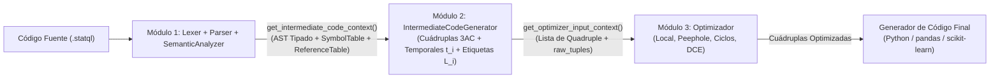
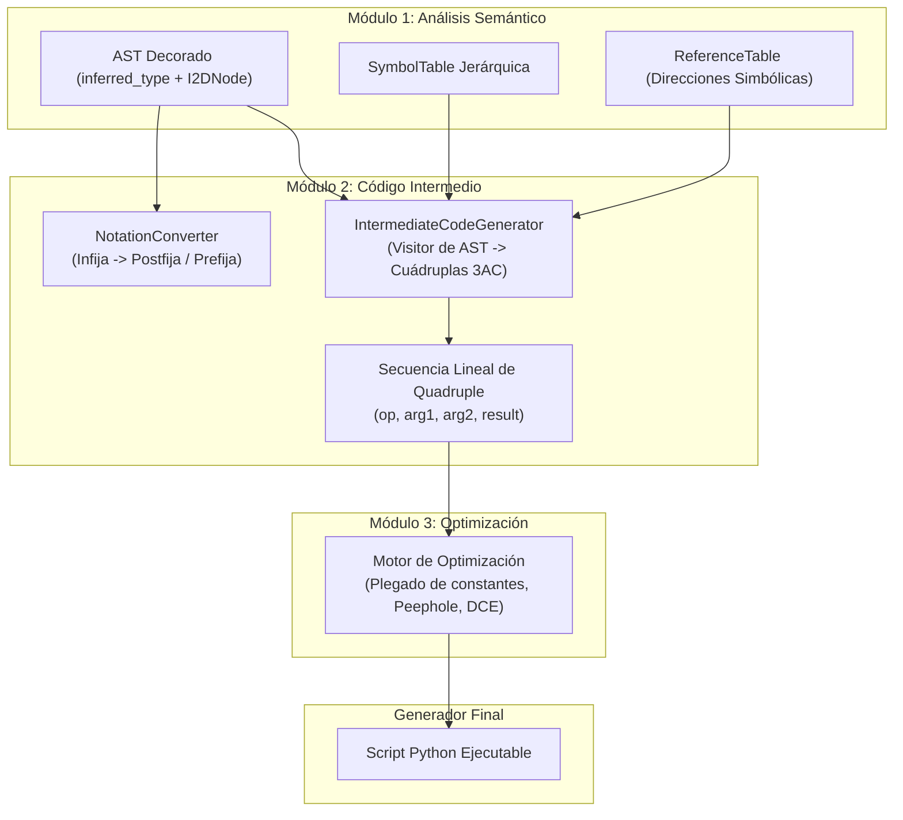

# Documentación Formal: Módulo 2 - Generación de Código Intermedio (3AC y Notaciones)
**Lenguaje:** StatQL (Statistical Query Language DSL)  
**Proyecto:** Compilador de Dominio Específico para Análisis Estadístico y Árboles de Decisión  
**Módulo:** 2 — Generación de Código Intermedio (Cuádruplas 3AC y Convertidor Infija/Postfija/Prefija)  
**Fecha:** 2026-11-17  
**Estado:** Terminado y Validado (100% de Pruebas Unitarias Aprobadas)

---

## 1. Introducción y Objetivos del Módulo 2

El presente documento constituye el reporte formal de ingeniería del **Módulo 2 (Código Intermedio)** para el compilador **StatQL**. Este módulo actúa como puente desacoplado entre el **Analizador Semántico (Módulo 1)** y las fases posteriores de **Optimización (Módulo 3)** y **Generación de Código Final**.

### Objetivos Técnicos Cumplidos
1. **Convertidor de Notaciones (`notation_converter.py`)**: Transformación determinista de expresiones infijas hacia **Notación Postfija (Polaca Inversa / RPN)** y **Notación Prefija (Polaca)** mediante recorridos en postorden y preorden sobre el AST tipado.
2. **Representación Intermedia en Cuádruplas 3AC (`ir_generator.py`)**: Traducción completa del AST decorado hacia instrucciones lineales de Código de Tres Direcciones con el formato `(operador, arg1, arg2, resultado)`.
3. **Preservación de Ámbitos y Direcciones Simbólicas**: Resolución sincronizada contra la `SymbolTable` y `ReferenceTable` del Módulo 1 (`sym_global_x_0`, `ds_datos_0`, `iter_alumno_1`, `model_modelo_1`), evitando colisiones por ocultamiento (*shadowing*).
4. **Cobertura Integral del Lenguaje**: Soporte completo para expresiones aritméticas/relacionales/lógicas, promociones explícitas `I2DNode`, declaraciones, asignaciones, estructuras condicionales (`si` / `sino`), bucles (`mientras` / `para cada`), carga tabular (`cargar`) y entrenamiento de modelos (`entrenar`).
5. **Contrato Desacoplado para Optimización**: Entrega estructurada de cuádruplas, tuplas puras, conteo de temporales/etiquetas y referencias para el Módulo 3.

---

## 2. Arquitectura del Compilador y Flujo de Datos

El módulo sigue el diseño modular desacoplado del repositorio:

```text
statql/
├── notation_converter.py  # Convertidor Infija -> Postfija (RPN) y Prefija (Polaca)
├── ir_generator.py        # Generador de Código Intermedio en Cuádruplas (Quadruple, IntermediateCodeGenerator)
└── __init__.py            # Exportaciones públicas actualizadas del paquete
tests/
└── intermediate/
    ├── __init__.py
    └── test_intermediate.py  # Suite de pruebas unitarias para notaciones, expresiones, flujo y DSL
docs/
└── 02_codigo_intermedio.md   # Este documento formal
```

### Diagrama de Bloques de la Tubería de Compilación



### Conexión Interna entre Semántico, Intermedio, Optimizador y Generador Final



---

## 3. Especificación del Código Intermedio Elegido

### 3.1 Justificación de Cuádruplas frente a Triplos y Notación Polaca
Se seleccionó el esquema de **Cuádruplas** `(op, arg1, arg2, result)` como representación intermedia principal por tres razones de ingeniería:
1. **Independencia posicional para el Optimizador (Módulo 3)**: A diferencia de los triplos (donde el resultado se referencia por el índice de la instrucción), en las cuádruplas el resultado vive en un temporal explícito (`t0`, `t1`, ...). Esto permite al Integrante 3 reordenar, eliminar o fusionar instrucciones sin invalidar referencias por índice.
2. **Integración directa con `ReferenceTable`**: Las variables de usuario se referencian mediante sus direcciones simbólicas inmutables (`sym_global_x_0`), mientras que las subexpresiones intermedias utilizan temporales (`t0`, `t1`, ...).
3. **Complementariedad con Notación Postfija y Prefija**: `NotationConverter` permite inspeccionar y validar la linealización de árboles de expresiones antes de emitir cuádruplas.

### 3.2 Repertorio Formal de Instrucciones (Cuádruplas 3AC)

| Categoría | Operador (`op`) | `arg1` | `arg2` | `result` | Semántica Operacional |
| :--- | :--- | :--- | :--- | :--- | :--- |
| **Aritmética** | `+`, `-`, `*`, `/` | Operando 1 | Operando 2 | `t_i` | `t_i = arg1 op arg2` |
| **Unarios** | `UMINUS`, `UPLUS`, `NOT` | Operando | `None` | `t_i` | Negación aritmética o lógica (`no`) |
| **Relacional** | `==`, `!=`, `<`, `>`, `<=`, `>=` | Operando 1 | Operando 2 | `t_i` | Comparación booleana |
| **Lógica** | `y`, `o` | Booleano 1 | Booleano 2 | `t_i` | Conjunción / disyunción lógica |
| **Conversión** | `I2D` | Operando `entero` | `None` | `t_i` | Promoción explícita a `decimal` |
| **Asignación** | `=` | Valor / Temporal | `None` | `sym_...` | Almacena el valor en la dirección simbólica |
| **Control** | `LABEL` | `None` | `None` | `L_...` | Define punto de destino de salto |
| **Control** | `GOTO` | `None` | `None` | `L_...` | Salto incondicional a `result` |
| **Control** | `IF_FALSE` | Condición (`t_i`) | `None` | `L_...` | Salta a `result` si `arg1` es falso |
| **Datos CSV** | `LOAD_CSV` | Ruta `"archivo.csv"` | `None` | `ds_...` | Carga tabla CSV en memoria simbólica |
| **Iteración** | `ITER_INIT` | `ds_...` | `None` | `t_cursor` | Inicializa cursor sobre la tabla |
| **Iteración** | `ITER_NEXT` | `t_cursor` | `None` | `iter_...` | Extrae siguiente fila (o falso al terminar) |
| **Acceso** | `GET_COL` | `iter_...` / `ds_...` | `"columna"` | `t_i` | Extrae valor de la columna de la fila |
| **ML** | `TRAIN_TREE` | `ds_...` | `"objetivo"` | `model_...` | Entrena árbol de decisión |
| **Salida / Fin** | `PRINT` / `HALT` | Expresión / `None` | `None` | `None` | Imprime valor o finaliza ejecución |

---

## 4. Traducción de Estructuras de Control y Expresiones

### 4.1 Convertidor Infija $\rightarrow$ Postfija y Prefija (`NotationConverter`)
Dado un árbol de expresión tipado, el convertidor aplica recorridos recursivos respetando la precedencia de operadores establecida en la gramática EBNF y los nodos `I2DNode` insertados por el Módulo 1:
- **Postfija (Postorden)**: `Izquierda -> Derecha -> Operador`  
  Ejemplo: `a + b * 2` (con `a: entero`, `b: decimal`) $\rightarrow$ `a I2D b 2 I2D * +`
- **Prefija (Preorden)**: `Operador -> Izquierda -> Derecha`  
  Ejemplo: `a + b * 2` $\rightarrow$ `+ I2D a * b I2D 2`

### 4.2 Plantillas de Generación de Control de Flujo

#### Condicional `si (cond) { B1 } sino { B2 }`
```text
<cuádruplas de cond -> t_cond>
(IF_FALSE, t_cond, _, L_else_0)
<cuádruplas de B1 en ámbito si_entonces>
(GOTO, _, _, L_endif_1)
(LABEL, _, _, L_else_0)
<cuádruplas de B2 en ámbito si_sino>
(LABEL, _, _, L_endif_1)
```

#### Bucle `mientras (cond) { B }`
```text
(LABEL, _, _, L_while_start_0)
<cuádruplas de cond -> t_cond>
(IF_FALSE, t_cond, _, L_while_end_1)
<cuádruplas de B en ámbito mientras>
(GOTO, _, _, L_while_start_0)
(LABEL, _, _, L_while_end_1)
```

#### Bucle Tabular `para cada fila en tabla { B }`
```text
(ITER_INIT, ds_tabla_0, _, t0)
(LABEL, _, _, L_foreach_start_0)
(ITER_NEXT, t0, _, iter_fila_1)
(IF_FALSE, iter_fila_1, _, L_foreach_end_1)
<cuádruplas de B en ámbito para_cada_fila>
(GOTO, _, _, L_foreach_start_0)
(LABEL, _, _, L_foreach_end_1)
```

---

## 5. Contrato de Integración con el Módulo 3 (Optimizador)

El generador expone el método `get_optimizer_input_context()` para que el Integrante 3 consuma el código intermedio sin depender del AST:

```python
from statql.lexer import Lexer
from statql.parser import Parser
from statql.semantic_analyzer import SemanticAnalyzer
from statql.ir_generator import IntermediateCodeGenerator

ast = Parser(Lexer(codigo_fuente).tokenize()).parse()
analyzer = SemanticAnalyzer()
analyzer.analyze(ast)

ir_gen = IntermediateCodeGenerator(analyzer.get_intermediate_code_context())
quads = ir_gen.generate()

opt_input = ir_gen.get_optimizer_input_context()
# opt_input["quadruples"]      -> List[Quadruple]
# opt_input["raw_tuples"]      -> List[Tuple[str, Any, Any, Any]]
# opt_input["temp_count"]      -> int (total de temporales t_i generados)
# opt_input["label_count"]     -> int (total de etiquetas L_i generadas)
# opt_input["reference_table"] -> ReferenceTable sincronizada
```

---

## 6. Validación y Ejecución de Pruebas (`tests/intermediate/`)

Se implementó la suite `tests/intermediate/test_intermediate.py` que verifica:
1. Conversión de expresiones infijas a notación postfija y prefija (incluyendo nodos `I2DNode`).
2. Generación de cuádruplas para expresiones aritméticas compuestas y casting explícito `I2D`.
3. Resolución de direcciones simbólicas por ámbito (`si` / `sino` con shadowing de variables).
4. Generación de etiquetas y saltos en bucles `mientras`.
5. Instrucciones específicas del dominio (`LOAD_CSV`, `ITER_INIT`, `ITER_NEXT`, `GET_COL`, `TRAIN_TREE`).

### Comando de Ejecución
Para ejecutar todas las pruebas del compilador (Módulo 1 + Módulo 2):
```bash
python -m unittest discover -s tests -v
```